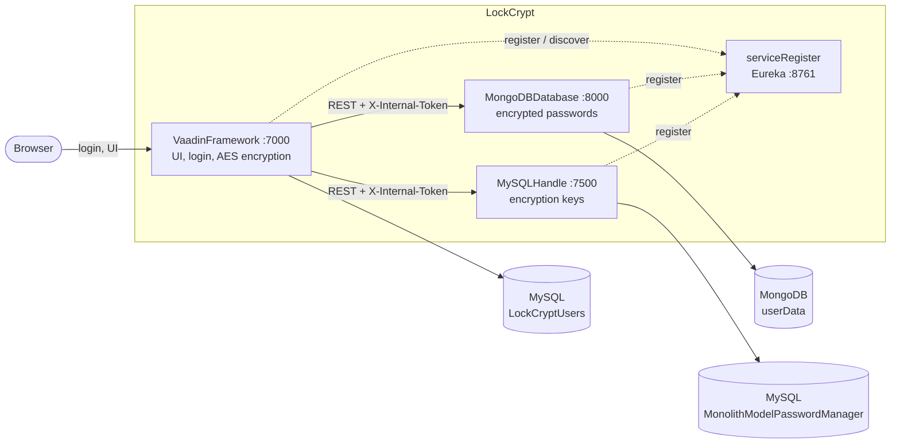
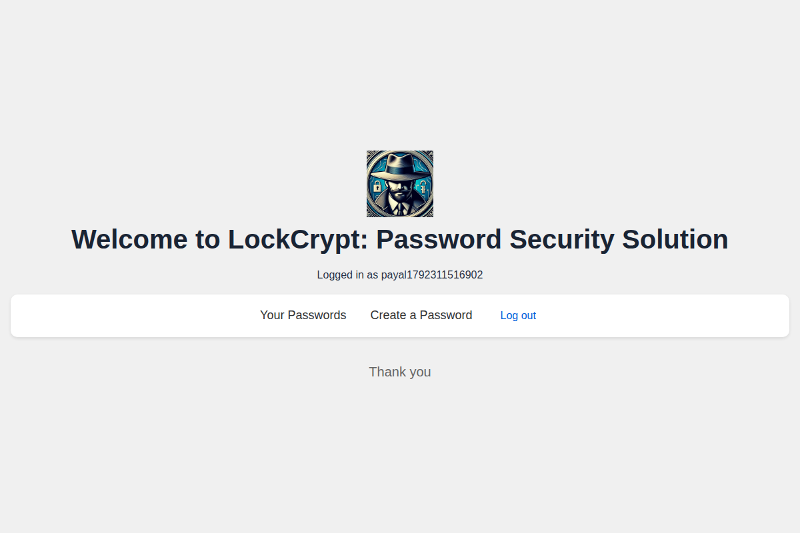
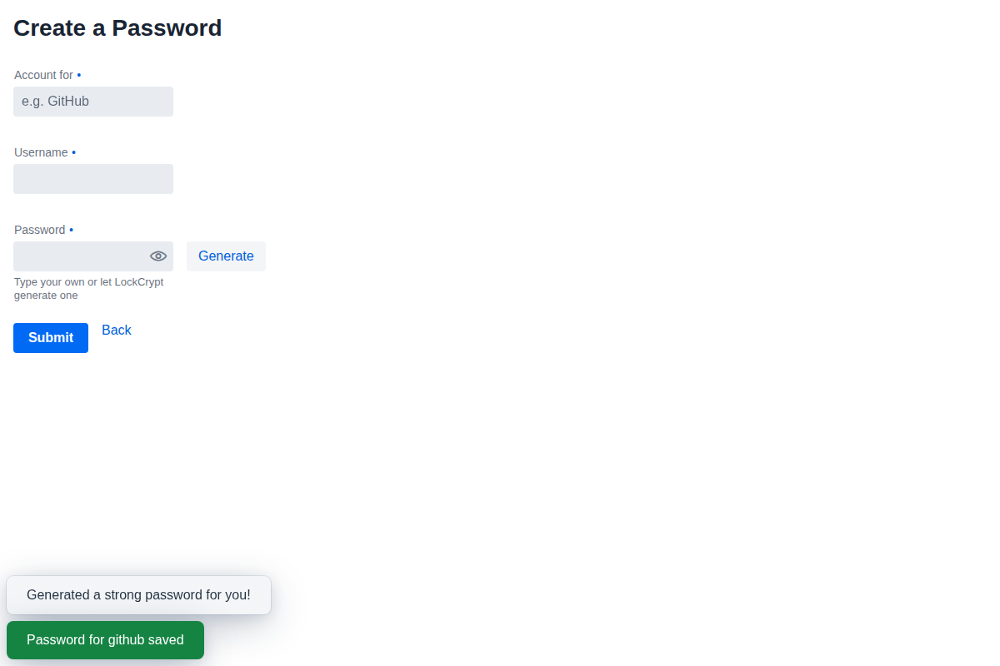
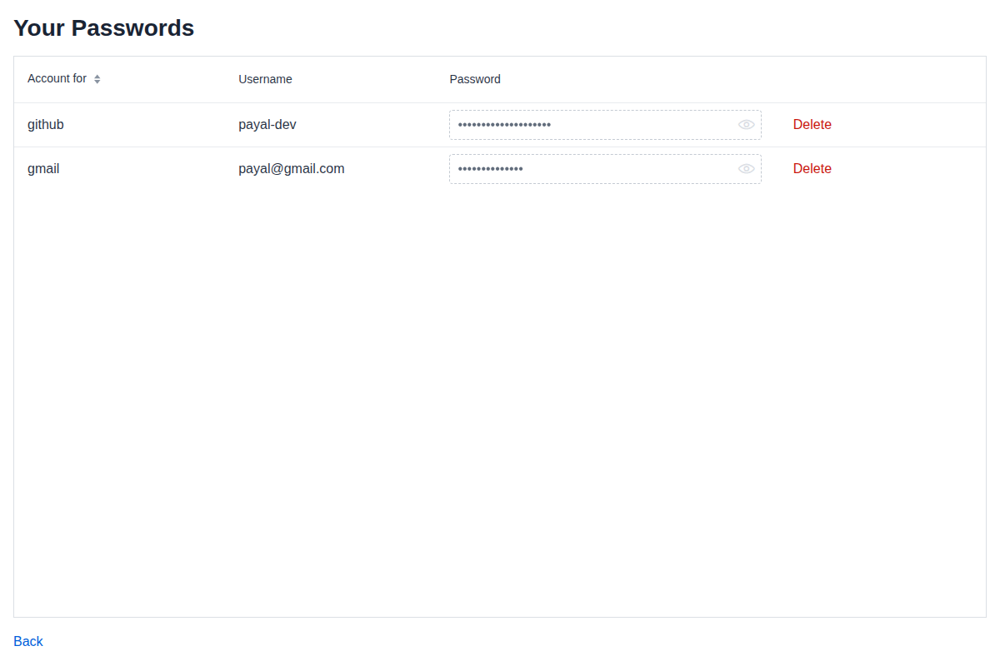

<p align="center">
  
</p>
<p align="center">
    <h1 align="center">LOCKCRYPT</h1>
</p>
<p align="center">
    <em>Password Security Solution</em>
</p>
<p align="center">
	
	
	
	
</p>
<p align="center">
	
	
	
	
	
	
	
</p>
<hr>

## Overview

LockCrypt is a password manager built as a set of Spring Boot microservices that find each other through a Eureka service registry.

The main idea is **split storage**: every saved password is encrypted with its own AES-256 key, the encrypted password is stored in **MongoDB** and the key is stored in **MySQL**, each behind its own service. Someone who gets hold of only one of the two databases cannot recover any password.

check out the older version of it at [Password Manager](https://github.com/payallenka/Password-Manager)

---

## Features

- **Register and log in** – Spring Security with BCrypt-hashed login passwords; every page except login/register needs an authenticated user.
- **Per-user data** – every record and key carries its owner, and both storage services only return or delete data for that owner.
- **Create a password** – type your own or let LockCrypt generate a strong one (20 characters, `SecureRandom`, always contains lowercase, uppercase, numbers and special characters).
- **View and delete passwords** – passwords are decrypted for the logged-in user and shown hidden by default with a reveal button.
- **AES-256-GCM encryption** – a fresh key and IV for every password; GCM also detects tampered data.
- **Service discovery** – services register with Eureka and are called by name (`http://MongoDBDatabase`, `http://MySQLHandle`) through a `@LoadBalanced` `RestTemplate`, so no host or port is hardcoded.
- **Service-to-service auth** – the storage services reject any request that does not carry the shared `X-Internal-Token`.
- **One command to run everything** – Docker Compose starts MySQL, MongoDB, Eureka and all services.

---

## Architecture



| Service | Port | Responsibility |
|---|---|---|
| `serviceRegister` | 8761 | Eureka server, every other service registers here |
| `VaadinFramework` | 7000 | Vaadin UI, login/registration, password generation, encryption and decryption |
| `MongoDBDatabase` | 8000 | Stores account, username and **encrypted** password, plus the id of its key |
| `MySQLHandle` | 7500 | Stores the **keys** |

### Saving a password

1. `VaadinFramework` generates a random 256-bit key and sends it to `MySQLHandle`, which returns the key's id.
2. The password is encrypted with that key (AES-GCM, random IV stored in front of the ciphertext).
3. The encrypted password, account, username and key id are sent to `MongoDBDatabase`.
4. If step 3 fails, the key from step 1 is deleted again so the two stores stay in sync.

### Viewing passwords

`VaadinFramework` fetches the user's records and keys, matches each record to its key **by key id** and decrypts it.

### REST API

Both storage services require the `X-Internal-Token` header.

| Service | Method | Path | Description |
|---|---|---|---|
| MongoDBDatabase | `GET` | `/userData?owner={owner}` | All records of a user |
| MongoDBDatabase | `POST` | `/userData` | Save a record (validated), returns `201` |
| MongoDBDatabase | `DELETE` | `/userData/{id}?owner={owner}` | Delete a record, `404` if it is not the owner's |
| MySQLHandle | `GET` | `/keys?owner={owner}` | All keys of a user |
| MySQLHandle | `POST` | `/keys` | Save a key (validated), returns `201` with its id |
| MySQLHandle | `DELETE` | `/keys/{id}?owner={owner}` | Delete a key, `404` if it is not the owner's |

---

## Repository Structure

```sh
LockCrypt/
├── pom.xml                  # parent pom: versions and the four modules
├── docker-compose.yml       # MySQL, MongoDB and all services
├── Dockerfile               # builds any module: --build-arg MODULE=<name>
├── .env.example             # copy to .env
├── serviceRegister/         # Eureka server
├── MongoDBDatabase/
│   └── src/main/java/com/lockcrypt/mongodbdatabase/
│       ├── configuration/   # InternalTokenFilter
│       ├── controller/      # UserDataController, ApiExceptionHandler
│       ├── model/           # UserData, UserDataRequest
│       ├── repository/      # UserRepository
│       └── service/         # UserDataService
├── MySQLHandle/
│   └── src/main/java/com/lockcrypt/mysqlhandle/
│       ├── configuration/   # InternalTokenFilter
│       ├── controller/      # PasswordController, ApiExceptionHandler
│       ├── model/           # Password, PasswordKeyRequest
│       ├── repository/      # PasswordKeyRepo
│       └── service/         # PasswordKeyService
└── VaadinFramework/
    └── src/main/java/com/lockcrypt/vaadinframework/
        ├── configuration/   # RestTemplateConfig (@LoadBalanced), SecurityConfig
        ├── frontend/        # MainView, DataReceive, DataDisplay, LoginView, RegisterView
        ├── model/           # UserData, KeysDetails, PasswordEntry, AppUser
        ├── repository/      # AppUserRepository
        └── service/         # MaskingService, PasswordGeneratorService, PasswordManagerService,
                             # UserDataService, KeysService, AppUserService
```

---

## Getting Started

### Run with Docker (recommended)

Requirements: Docker with Compose.

```sh
git clone https://github.com/payallenka/LockCrypt
cd LockCrypt
cp .env.example .env        # then set MYSQL_PASSWORD and INTERNAL_TOKEN
docker compose up --build
```

- App: http://localhost:7000 – create an account on the register page, then log in.
- Eureka dashboard: http://localhost:8761 – `MONGODBDATABASE`, `MYSQLHANDLE` and `VAADINFRAMEWORK` should be listed.

Give the services ~30 seconds after startup to register with Eureka. Only ports 7000 and 8761 are published; the storage services are reachable only inside the Docker network.

To use MongoDB Atlas instead of the local container, set `MONGODB_URI` in `.env`.

### Run locally without Docker

Requirements: JDK 17, a running MySQL 8 and MongoDB.

```sh
export MYSQL_PASSWORD=<your mysql root password>
export INTERNAL_TOKEN=<any long random string>
# optional: export MONGODB_URI=mongodb+srv://...

./mvnw -pl serviceRegister spring-boot:run     # start this first
./mvnw -pl MongoDBDatabase spring-boot:run
./mvnw -pl MySQLHandle spring-boot:run
./mvnw -pl VaadinFramework spring-boot:run
```

The databases are created automatically (`createDatabaseIfNotExist=true`, `ddl-auto=update`).

### Configuration

| Variable | Used by | Default |
|---|---|---|
| `INTERNAL_TOKEN` | all except `serviceRegister` | – (required) |
| `MYSQL_PASSWORD` | `MySQLHandle`, `VaadinFramework` | – (required) |
| `MYSQL_USERNAME` | `MySQLHandle`, `VaadinFramework` | `root` |
| `MYSQL_URL` | `MySQLHandle`, `VaadinFramework` | `localhost:3306` |
| `MONGODB_URI` | `MongoDBDatabase` | `mongodb://localhost:27017/LockCrypt` |
| `EUREKA_URL` | all clients | `http://localhost:8761/eureka` |

### Tests

```sh
./mvnw verify
```

79 tests across the four modules, covering:

- **Encryption** – round trip, passwords of any length, unique ciphertext per call, wrong key, tampered data and garbage input.
- **Password generator** – length, all four character groups present, no repeats over 1,000 runs.
- **PasswordManagerService** – records matched to keys by id (not by order), orphaned entries skipped, key rolled back when saving the record fails, delete removes both.
- **Registration and login** – BCrypt hashing, taken usernames, short passwords, unknown users.
- **REST controllers** – validation (`400`), owner scoping (`404`), requests without the internal token (`401`).

CI runs the same command on every push.

The full stack has also been tested end to end with Docker Compose: register → log in → generate and save → view (decrypted) → delete, plus a second user seeing none of the first user's passwords, a wrong login password being rejected, and logout ending the session.

---

## Screenshots

<p align="center"></p>
<p align="center"><em>Landing page</em></p>

<p align="center"></p>
<p align="center"><em>Password creation page</em></p>

<p align="center"></p>
<p align="center"><em>Password view page</em></p>

---

## Limitations and next steps

- Keys are generated and used on the server, so `VaadinFramework` can decrypt every password. Deriving the keys from a master password the user types in (e.g. with PBKDF2/Argon2) would mean even the server could not read them.
- Traffic between services is plain HTTP protected by a shared token; mTLS or OAuth2 client credentials would be the production-grade option.
- An API gateway (Spring Cloud Gateway) and centralised configuration would be the next steps on the microservices side.

---

## Contributing

Contributions are welcome! Open an [issue](https://github.com/payallenka/LockCrypt/issues) or a pull request.

1. Fork the repository and create a branch: `git checkout -b new-feature-x`
2. Make your changes and run `./mvnw verify`
3. Commit with a clear message and open a pull request against `main`
